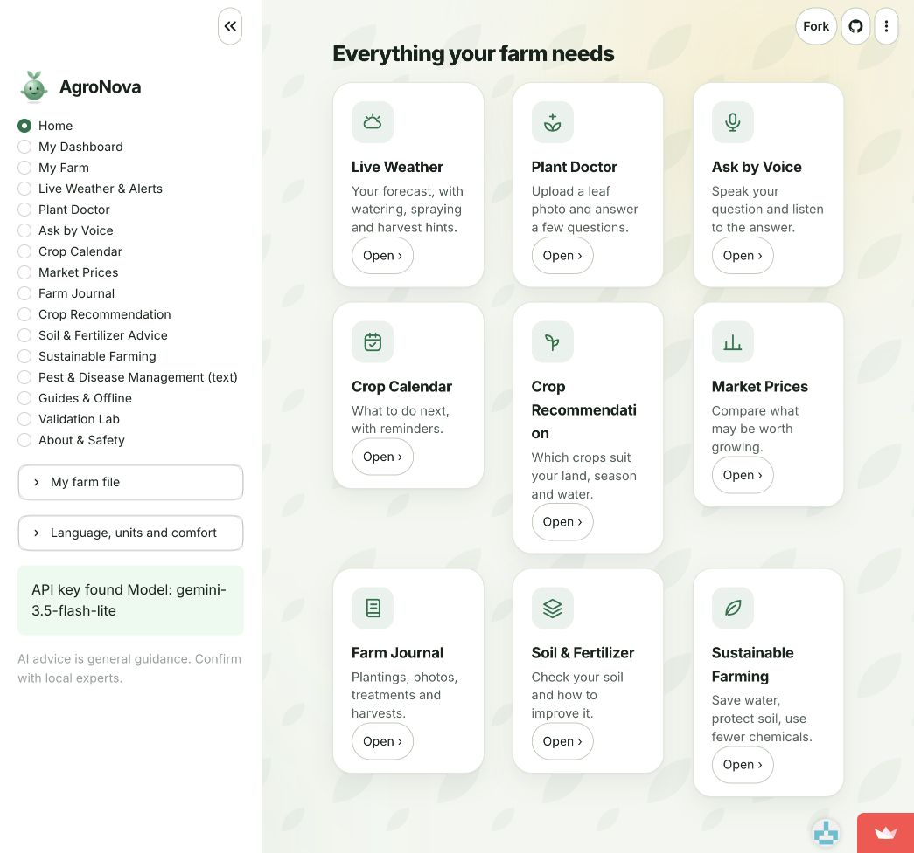
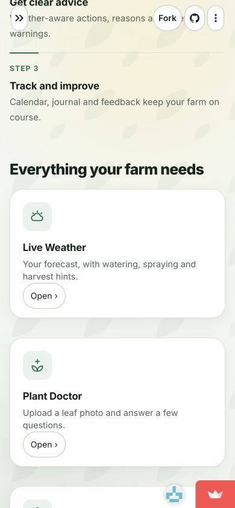

<p align="center"></p>

# AgroNova Smart Farming Assistant

[Open the live app](https://agronova-intelligence.streamlit.app) · [Application source](AgroNova/) · [Validation evidence](docs/validation/validation_log.json)

AgroNova is a Python and Streamlit farming assistant powered by Google Gemini. Farmers can enter their country, crop, soil and water situation and receive advice with explanations and precautions in one of 12 languages.

## Features

The five core features are crop recommendations, pest and disease guidance, weather-based advice, soil and fertilizer advice, and sustainable farming. The menu includes both user-reported weather advice and a separate live forecast page.

Additional tools include a saved farm profile, Open-Meteo forecasts, Plant Doctor photo questions, voice transcription, browser speech, crop calendars with ICS export, a farm journal and downloadable HTML offline packs. The live app requires an internet connection.

Market Prices uses official Indian mandi data when a data.gov.in key is configured, European Commission weekly cereal reports for EU countries, and farmer-entered prices elsewhere. Crop comparisons calculate margins from supplied numbers. Coverage, reporting dates and units vary.

## Validation evidence

On 4 November 2026, the deployed app returned answers to six regional prompts covering India, Ghana and Canada. Seven responses were saved: one V1/V2 comparison and five additional V2 answers. Full original prompts, model settings, responses and qualitative review notes are in [the real API log](docs/validation/validation_log.json).

The Tamil Nadu crop comparison produced 577 words for V1 and 282 for V2. V2 followed the five-heading format and included a local expert referral. This is evidence of formatting changes, not proof of greater factual accuracy. Review found assumptions about future rain, seed reuse, pest controls and tillage. The prompt rules were strengthened in response. Revised prompts still need a fresh live evaluation.

The log preserves the original unchecked checklist fields. They are not passed quality scores. [The review summary](docs/validation/review.md) records what was checked, unresolved issues and the sources used.

Local verification after the code fixes: 58 automated tests passed and 125 mocked page scenarios passed. Mocked checks test application logic and code paths. They do not replace real API testing or checks on physical devices.

## Screenshots

Desktop browser capture:



Phone-size browser viewport, 390 × 844:



These captures show the deployed interface before the final navigation and wording fixes. The phone capture is a responsive browser check, not a physical-phone test.

## Run locally

```bash
git clone https://github.com/adrian-hue-pixel/AgroNova.git
cd AgroNova/AgroNova
python -m venv .venv
source .venv/bin/activate
pip install -r requirements.txt
streamlit run app.py
```

On Windows, activate with `.venv\Scripts\activate` instead.

Create `.streamlit/secrets.toml` from the example inside the application directory and set `GEMINI_API_KEY`. Keep the real secrets file out of GitHub. `GEMINI_MODEL` can override the default. The deployed app identified its model as `gemini-3.5-flash-lite` during the recorded runs.

The project uses the `google-genai` SDK. The original assessment names Gemini 1.5 and `google-generativeai`. The submitted implementation uses the SDK and model configured in the working app. Other dependencies are Streamlit, pandas, Pillow and certifi, as listed in [requirements.txt](AgroNova/requirements.txt).

## Streamlit Cloud configuration

Repository: `adrian-hue-pixel/AgroNova`  
Branch: `main`  
Main file: `AgroNova/app.py`  
Secrets: configure `GEMINI_API_KEY` in Streamlit Cloud. Never paste keys into source files or the README.

## Checks

Run from the inner `AgroNova` application directory:

```bash
python -m unittest discover -s tests -v
python tests/smoke_app_with_stub_streamlit.py
```

Before submission, open the public app on a physical phone and laptop, generate an answer, check feedback and downloads, and record the results. Controlled temperature and token-limit experiments remain to be documented. A deployment link alone does not demonstrate every assessment criterion.

## Safety and data

Advice is general guidance. Gemini can make mistakes and cannot confirm a disease from text or a photo. Check important decisions with a local agricultural officer. The prompts prohibit exact pesticide and fertilizer doses, invented forecasts and invented market prices.

Farm information stays in the server-side Streamlit session unless the farmer downloads it or the owner enables local saving. Photos and audio go to Gemini when the user requests those features. Shared local saving is off by default. Feedback files and session data may disappear when Streamlit restarts.

## Credits

Student: Adrian Rohith C  
Registration number: 1000528  
Mentor: Aruljothi M  
School: Jain Vidyalaya IBCP World School

Built for the Generative AI FA-1 and FA-2 Smart Farming Assistant assessment.
